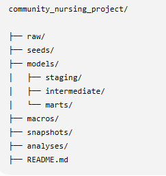
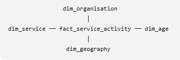
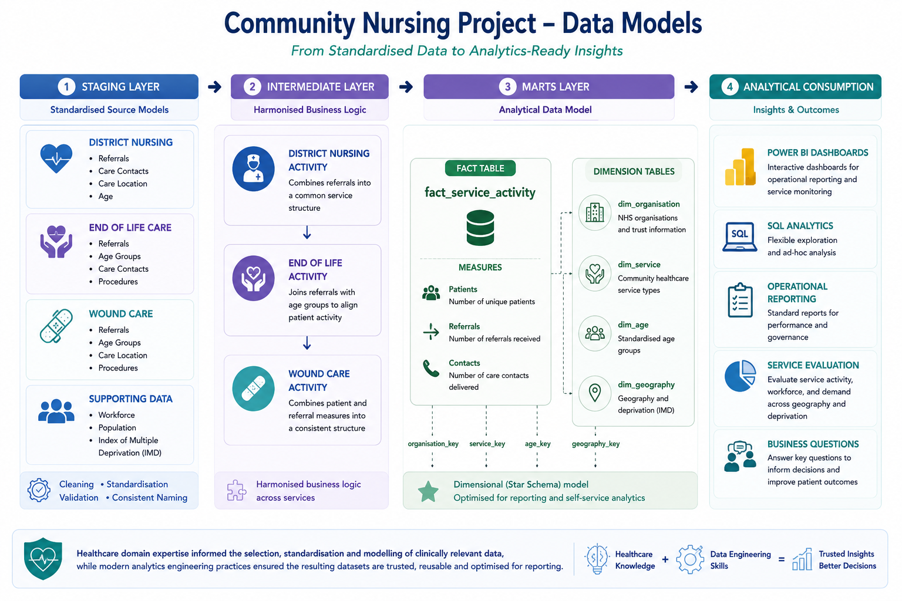

Version: 1.0
Released: July 2026
## banner

**--EXECUTIVE SUMMARY--**
Community Nursing Analytics Project
An end-to-end Analytics Engineering project demonstrating
* Snowflake
* dbt
* SQL
* Python
* Git/GitHub
* ELT
* Dimensional Modelling
* Data Quality Testing
* Healthcare Analytics
## Snowflake

**--PROJECT OVERVIEW--**
The Community Nursing Project is an end-to-end ELT data engineering project that transforms publicly available NHS England community healthcare datasets into a clean, trusted and analytics-ready data warehouse using modern cloud data engineering practices.

The project ingests multiple community nursing datasets covering district nursing activity, end-of-life care, wound care, workforce, population, and deprivation data before standardising, validating and modelling them into an analytical star schema using Snowflake and dbt.

Rather than simply cleaning data, the project demonstrates how disparate healthcare datasets can be integrated into reusable analytics platform capable of supporting operational reporting, service evaluation and strategic decision-making.

A dimensional data model enables consistent reporting across organisations while automated testing ensures the data remains accurate, reliable and suitable for downstream analysis.

This project demonstrates the complete lifecycle of a modern analytics engineering solution:
* Loading raw NHS datasets into Snowflake
* Building a layered ELT pipeline with dbt
* Standardising inconsistent healthcare data
* Applying automated data quality tests
* Creating dimensional models for reporting
* Producing business-ready datasets capable of answering real operational questions

**--PURPOSE--**
This project was designed to bridge my career in senior NHS leadership with my transition into Data Engineering.

Having spent more than a decade working within the NHS, including community nursing, quality improvement, quality assurance, patient safety, and healthcare evaluation, I recognised that healthcare organisations generate vast amounts of valuable operational data, but often struggle to transform it into meaningful information that supports better decisions.

Throughout my career I regularly collected, input, analysed clinical and operational data, designed reporting frameworks, developed evaluation methodologies and present insights to senior leaders to support service improvement. This project extends those skills by applying modern cloud data engineering tools to build a reproducible analytics platform.

Unlike many portfolio projects built around synthetic datasets, this project focuses on genuine healthcare data and reflects many of the challenges encountered in real organisations, including:
•	Integrating multiple independent data sources
•	Standardising inconsistent data
•	Modelling complex healthcare information
•	Validating data quality
•	Creating reusable analytical datasets
•	Supporting evidence-based decision-making

The project demonstrates not only technical capability in SQL, Snowflake, dbt, Python, and Git, but also the domain knowledge required to understand healthcare data, ask meaningful business questions and design reporting that delivers value to clinicians, operational managers, and healthcare leaders for continuous improvement.

**--DATA ARCHITECTURE AND PIPELINE--**
This data architecture leverages senior healthcare experience, ensuring the right data is extracted, shaped, and modelled to answer real business questions, combined with modern data engineering skills to build a robust, scalable, and reliable analytics platform.
## data_architecture

**--DATA MODELS--**
Healthcare domain expertise informed the selection, standardisation and modelling of clinically relevant data, while modern analytics engineering practices ensured the resulting datasets are trusted, reusable and optimised for reporting.
## star_schema

## data_models

**--TECHNOLOGIES--**
The Community Nursing Project used a modern ELT architecture built around cloud data warehousing and analytics engineering principles. Each technology was selected to demonstrate an industry-standard approach to building scalable, maintainable and analytics-ready data pipelines.
## Technologies used and skills demonstrated

**--DATA QUALITY TESTING--**

RAW LAYER

Raw datasets were manually reviewed to identify issues that would affect downstream processing. 
	
Checks included:
* Consistent column headers across datasets. 
* Data type validation (e.g. correcting age bands interpreted as dates in Excel). 
* Removal of inconsistent formatting. 
* Standardisation of categorical values (for example, ensuring consistent MV/OP values). 
* Verification that all expected source files loaded successfully into the raw layer using the Python ingestion script.

STAGING LAYER
Transformation Validation, standardisation and cleaning to produce consistent datasets.

Validation included:
* Consistent naming conventions across all staging models. 
* Standardised organisation names and codes. 
* Removal of formatting inconsistencies. 
* Validation of joins between source datasets. 
* Verification of row counts between raw and staging tables where appropriate. 
* Manual inspection of transformed data for plausibility.

DBT TESTS
* Unique - Ensures surrogate keys are unique
* Not Null - validates mandatory key fields
* Relationships - verifies referential integrity between fact and dimension tables

MANUAL QUALITY ASSURANCE
Verified tables materialised in the correct Snowflake schemas. 
* Verified dimensional relationships. 
* Spot-checked transformed records. 
* Compared row counts between layers. 
* Confirmed warehouse architecture matched the documented design.

**--Business Questions Answered--**
1. How does community nursing demand vary between organisations when considered alongside workforce capacity, population and deprivation?
2.     Data Used: Activity+ Organisation
3. Does workforce capacity appear aligned with demand?
4.     Data Used: Workforce + activity
5. Is service demand proportional to local population size?
6.     Data used: ONS + activity
7. Does deprivation appear to influence community nursing activity?
8.     Data used: IMD + activity
9. Which age groups account for teh greatest service demand?
10.     Data used: age + activity

**--SCREENSHOTS--**
## Project Screenshots

Additional screenshots demonstrating the pipeline, Snowflake warehouse, dbt lineage, and final data models can be viewed **[here](images/screenshots.md)**.

**--RESULTS--**
The project successfully integrated multiple NHS England, ONS, and deprivation datasets into a single analytical warehouse. The resulting dimensional model enables consistent analysis of community nursing demand by organisation, geography, service type and age group while demonstrating a modern ELT workflow using Snowflake and dbt. The resulting warehouse provides reusable analytical datasets that can support future reporting, dashboard development service evaluation.

**--DATA SOURCES, LICENSING, AND DISCLAIMER--**
This project uses publicly available healthcare datasets published by UK government organisations. The data are used here solely for education, demonstration, and portfolio purposes to showcase modern data engineering and analytics engineering techniques.

The raw data files in this repository are extracts from publicly available datasets where redistribution is permitted. Where applicable, the original data providers retain all rights, ownership, and intellectual property relating to the source data.
Disclaimer:
•	This repository contains no confidential, patient-identifiable or sensitive information.
•	The analytical models, transformations, business questions and visualisation were independently developed for education and portfolio purposes.
•	The analyses and conclusions presented are the author’s own and do not represent official NHS England reporting or guidance.

Sources:
NHS England - Community Health Services Statistics (District Nursing, End-of-Life-Care, Wound Care, and Community Workforce datasets)

**--LIMITATIONS AND DATA QUALITY FINDINGS--**
The following considerations should be taken into account when interpreting the analytical outputs.

1.	The NHS workforce datasets did not contain workforce records for 9 of the 64 community healthcare organisations included within the clinical activity datasets.
    These organisations were retained within the analytical model to preserve complete clinical reporting. However, they were excluded from workforce-capacity analyses where workforce measures were unavailable.

2.	Some NHS community healthcare organisations provide service across multiple Local Authorities and Office for National Statistics (ONS) population areas. 
    To simplify the portfolio implementation, each organisation has been assigned a single primary geography within the dimensional model. While this enables consistent reporting, it does not fully represent                 organisations whose services span multiple geographic areas.

3.	The three clinical service domains are published at different levels of aggregation. For example, referral counts may be reported at organisation level, while age distributions are reported at organisation and age-      band level.
    To create a complete end-to-end dimensional warehouse, the intermediate models standardise these datasets into a common analytical structure without redistributing measures across different levels of granularity.
    As a result, the warehouse accurately demonstrates modern ELT architecture, dbt transformations, dimensional modelling and analytics engineering practices. However, analytical outputs should not be interpreted as        statistically precise across every dimensional combination, as they remain constrained by the structure of the published source data.

This project was intentionally scoped to demonstrate a complete analytics engineering workflow within the constraints of publicly available data and the available development environment. The implementation prioritises clear architecture, maintainable transformations and reproducible analytical models while acknowledging the limitations inherent in the published datasets.

**--CONTINUOUS IMPROVEMENTS--**
This project is undergoing continuous improvements through a planned Version 2 coming soon, and future ideas logged here as longer-term improvements are recognised.

Version 2

•	PostgreSQL implementation 
    Extend the dimensional model to include additional NHS Community Services Data Sets (CSDS) publications as they become available.
    Expand the analytical layer with additional fact tables covering workforce capacity, care contacts and referral pathways.

•	Dbt Core 
    Introduce more comprehensive dbt tests, including customer business-rule validations and source freshness monitoring

•	Bridge Table
    Replace simplified geographic mappings with many-to-many relationships using bridge tables to support organisations service multiple Local Authorities and ONS population areas.

•	Power BI
    Enhance the Power BI reporting layer with additional operational dashboards and executive performance indicators.
•	Analysis Report

Future Ideas

Planned enhancements include:

•	Docker
    Containerise the project using Docker to improve portability and deployment consistency.
•	CI/CD
    Implement CI/CD using GitHub Actions to automate testing and deployment

•	Azure Data Factory
    Introduce orchestration using tools such as Azure Data Factory to schedule and monitor pipeline execution.

•	API Ingestion
    Automate data ingestion directly from published source files or APIs to remove manual extraction and preparation steps.

