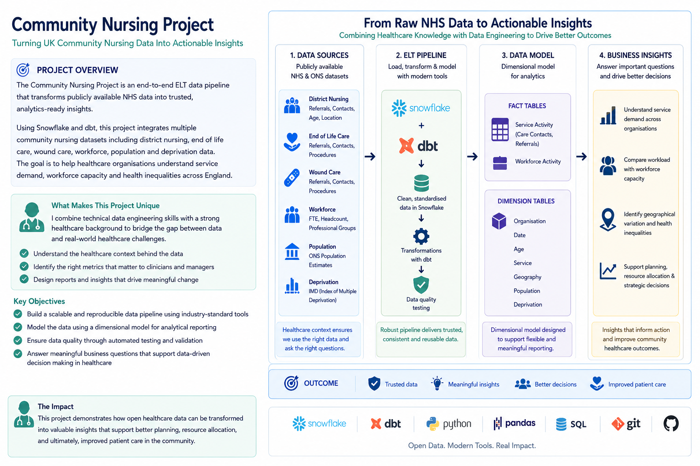
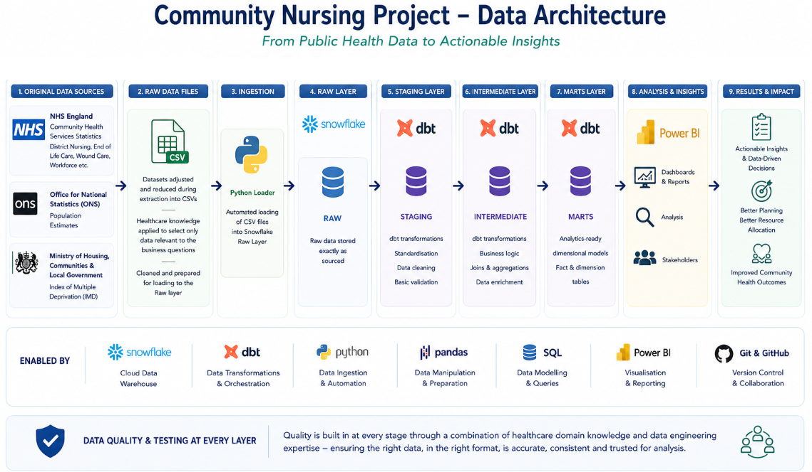

Version: 1.0
Released: July 2026
## Project Banner

**README.md**

**--EXECUTIVE SUMMARY--**
Community Nursing Analytics Project
An end-to-end Analytics Engineering project demonstrating
* Snowflake
* dbt
* SQL
* Python
* Git/GitHub
* ELT
* Dimensional Modelling
* Data Quality Testing
* Healthcare Analytics
## Snowflake

**--PROJECT OVERVIEW--**
The Community Nursing Project is an end-to-end ELT data engineering project that transforms publicly available NHS England community healthcare datasets into a clean, trusted and analytics-ready data warehouse using modern cloud data engineering practices.

The project ingests multiple community nursing datasets covering district nursing activity, end-of-life care, wound care, workforce, population, and deprivation data before standardising, validating and modelling them into an analytical star schema using Snowflake and dbt.

Rather than simply cleaning data, the project demonstrates how disparate healthcare datasets can be integrated into reusable analytics platform capable of supporting operational reporting, service evaluation and strategic decision-making.

A dimensional data model enables consistent reporting across organisations while automated testing ensures the data remains accurate, reliable and suitable for downstream analysis.

This project demonstrates the complete lifecycle of a modern analytics engineering solution:
* Loading raw NHS datasets into Snowflake
* Building a layered ELT pipeline with dbt
* Standardising inconsistent healthcare data
* Applying automated data quality tests
* Creating dimensional models for reporting
* Producing business-ready datasets capable of answering real operational questions

**--PURPOSE--**
This project was designed to bridge my career in senior NHS leadership with my transition into Data Engineering.

Having spent more than a decade working within the NHS, including community nursing, quality improvement, quality assurance, patient safety, and healthcare evaluation, I recognised that healthcare organisations generate vast amounts of valuable operational data, but often struggle to transform it into meaningful information that supports better decisions.

Throughout my career I regularly collected, input, analysed clinical and operational data, designed reporting frameworks, developed evaluation methodologies and present insights to senior leaders to support service improvement. This project extends those skills by applying modern cloud data engineering tools to build a reproducible analytics platform.

Unlike many portfolio projects built around synthetic datasets, this project focuses on genuine healthcare data and reflects many of the challenges encountered in real organisations, including:
•	Integrating multiple independent data sources
•	Standardising inconsistent data
•	Modelling complex healthcare information
•	Validating data quality
•	Creating reusable analytical datasets
•	Supporting evidence-based decision-making

The project demonstrates not only technical capability in SQL, Snowflake, dbt, Python, and Git, but also the domain knowledge required to understand healthcare data, ask meaningful business questions and design reporting that delivers value to clinicians, operational managers, and healthcare leaders for continuous improvement.

**--DATA ARCHITECTURE AND PIPELINE--**
This data architecture leverages senior healthcare experience, ensuring the right data is extracted, shaped, and modelled to answer real business questions, combined with modern data engineering skills to build a robust, scalable, and reliable analytics platform.
## Data Architecture

**--DATA MODELS--**
Healthcare domain expertise informed the selection, standardisation and modelling of clinically relevant data, while modern analytics engineering practices ensured the resulting datasets are trusted, reusable and optimised for reporting.
## star_schema

## Data Models

**--TECHNOLOGIES--**
The Community Nursing Project used a modern ELT architecture built around cloud data warehousing and analytics engineering principles. Each technology was selected to demonstrate an industry-standard approach to building scalable, maintainable and analytics-ready data pipelines.
## Tech and Skills

![Tech and Skills](images/Technologies

