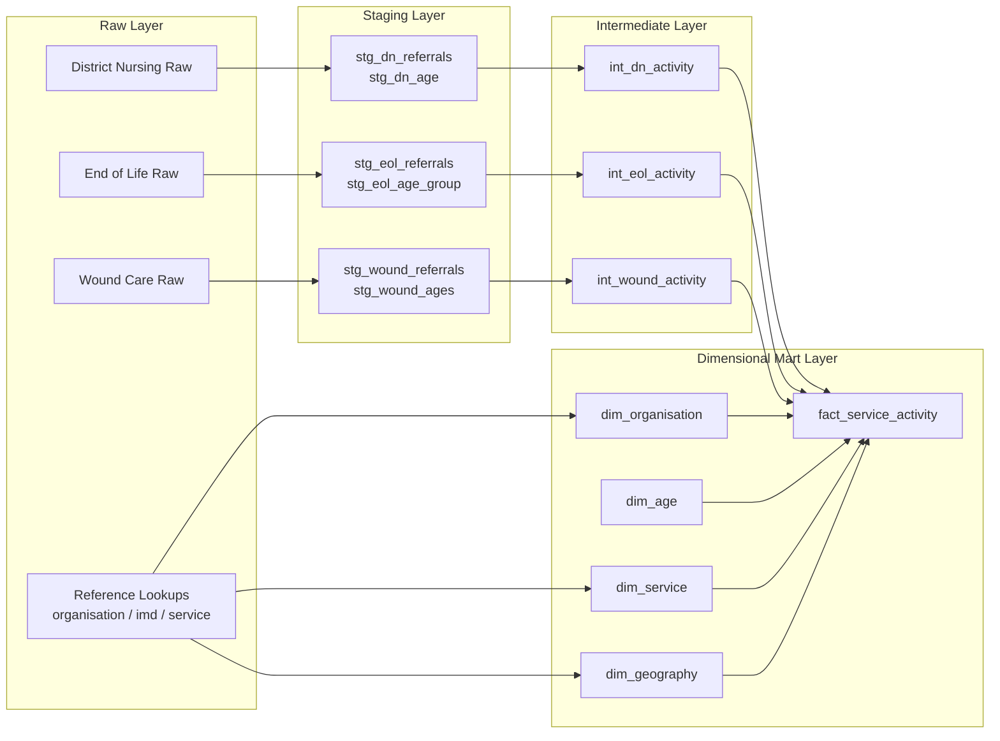

# Community Nursing Model Architecture

This model architecture combines the raw and staging concepts from the CNP architecture diagram with the dimensional and mart design from the data architecture diagram.

## Layered Data Model



## Purpose of Each Layer

### 1. Raw Layer
- Stores source datasets for community nursing activity.
- Includes operational data for district nursing, end of life, and wound care.
- Also includes reference lookups for organisation, service, and deprivation information.

### 2. Staging Layer
- Standardises source data.
- Renames fields where needed.
- Applies consistent data types and prepares the data for downstream modelling.
- Examples include:
  - stg_dn_referrals
  - stg_dn_age
  - stg_eol_referrals
  - stg_eol_age_group
  - stg_wound_referrals
  - stg_wound_ages

### 3. Intermediate Layer
- Combines service-specific activity into a common format.
- Creates a unified activity grain for reporting.
- Models:
  - int_dn_activity
  - int_eol_activity
  - int_wound_activity

### 4. Dimensional Mart Layer
- Builds a star schema for analytics and reporting.
- Dimensions describe the business context of the activity.
- The fact table stores the measurable activity.

#### Dimensions
- dim_organisation
- dim_age
- dim_service
- dim_geography

#### Fact Table
- fact_service_activity

## Star Schema Summary

The mart layer is designed to answer questions such as:
- How much activity occurred by service?
- How does activity vary by organisation or geography?
- How does activity differ by age group?
- Which services are contributing most to referrals and patients?

## Recommended dbt Structure

```text
models/
  staging/
    stg_dn_referrals.sql
    stg_dn_age.sql
    stg_eol_referrals.sql
    stg_eol_age_group.sql
    stg_wound_referrals.sql
    stg_wound_ages.sql
  intermediate/
    int_dn_activity.sql
    int_eol_activity.sql
    int_wound_activity.sql
  marts/
    dim_organisation.sql
    dim_age.sql
    dim_service.sql
    dim_geography.sql
    fact_service_activity.sql
```
